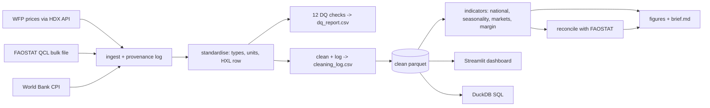

# Kenya Staples Market Analytics

An end-to-end, reproducible data-analyst portfolio project: **ingest, validate, clean, reconcile, analyse, visualise and report** on real public agricultural data for Kenya.

**Question:** How do maize prices behave across Kenyan markets, where and when are they most volatile, and do national production (FAO) and market prices (WFP) tell a consistent story?

**Data (all public):** WFP Kenya food prices via the Humanitarian Data Exchange; FAOSTAT crop production; World Bank CPI (optional). Details and licences: [`docs/data_sources.md`](docs/data_sources.md).

> Findings are not hard-coded. Running the pipeline regenerates every number, chart and the management brief from the latest data.

## What this project demonstrates

| Analyst skill | Where to look |
|---|---|
| Reliable, repeatable data workflow | [`agrimarket/pipeline.py`](agrimarket/pipeline.py), [`ingest.py`](agrimarket/ingest.py) (download plus provenance log), `Makefile`, CI |
| Cleaning, validation, reconciliation | [`clean.py`](agrimarket/clean.py), [`quality.py`](agrimarket/quality.py) (12 checks), [`reconcile.py`](agrimarket/reconcile.py) (WFP vs FAOSTAT) |
| Data quality documentation | [`docs/data_quality_framework.md`](docs/data_quality_framework.md); generated `outputs/dq_report.csv` and `cleaning_log.csv` |
| Indicators with clear definitions | [`docs/indicator_dictionary.md`](docs/indicator_dictionary.md), [`indicators.py`](agrimarket/indicators.py) |
| SQL | [`sql/queries.sql`](sql/queries.sql): window functions, filtered aggregates, self-joins on DuckDB |
| Dashboards | [`dashboard/app.py`](dashboard/app.py) (Streamlit, 5 tabs) |
| Trend, seasonality, segmentation, margin analysis | [`indicators.py`](agrimarket/indicators.py), [`analysis.py`](agrimarket/analysis.py) |
| Plain-language reporting | auto-generated `outputs/brief.md`; [`docs/stakeholder_brief_template.md`](docs/stakeholder_brief_template.md) |
| Improving data collection | "Recurring-error loop" in the DQ framework; DQ report records the action for each finding |
| Documentation, confidentiality, responsible use | [`docs/methodology.md`](docs/methodology.md), [`docs/data_protection.md`](docs/data_protection.md) |
| Software quality | `tests/` (8 tests, including an end-to-end run), GitHub Actions workflow |

## Architecture



## Quick start

```bash
git clone https://github.com/erastus-mwangi-njoroge/kenya-staples-market-analytics && cd kenya-staples-market-analytics
python -m venv .venv && source .venv/bin/activate    # Windows: .venv\Scripts\activate
pip install -r requirements.txt

python -m agrimarket.pipeline        # downloads data, runs everything (a few minutes)
python sql/run_sql.py                # SQL analyses -> outputs/sql/*.csv
streamlit run dashboard/app.py       # interactive dashboard
python -m pytest -q                  # tests (no network needed)
```

Other commodities (for example `--commodity Beans`, `--commodity Sorghum`) work for the price analysis; the FAOSTAT reconciliation needs a crop present in FAOSTAT.
If a download is blocked, put the files in `data/raw/` manually (`wfp_food_prices_ken.csv`, `faostat_qcl_normalized.zip`, optional `wb_cpi_kenya.csv`) and run with `--skip-download`.

## Outputs (generated in `outputs/`)

| File | Purpose |
|---|---|
| `brief.md` | One-page management brief with headline numbers, markets to watch, caveats and suggested actions |
| `dq_report.csv`, `cleaning_log.csv` | Data-quality findings and every correction applied |
| `national_monthly.csv`, `seasonality.csv`, `market_summary.csv`, `retail_wholesale_margin.csv`, `reconciliation.csv` | Analysis tables behind every chart |
| `figures/*.png` | Trend with spikes, seasonality, market segments, supply vs price, margin |

## Key findings 

"National maize prices in Oct 2026 were +4.3% above a year earlier; the last 0 months included spikes."


Embedded chart: `](image-1.png) 

## Limitations
WFP prices are market observations, not farm-gate prices; market coverage is uneven; FAOSTAT includes estimates; nominal prices embed inflation. See [`docs/methodology.md`](docs/methodology.md).

## Possible extensions
Add rainfall/NDVI to explain spikes; add FinAccess or KIHBS survey data for farmer-finance analysis (see data sources); forecast prices with a seasonal model and back-test it.

## Author
Erastus Mwangi · eramwangiz@gmail.com · https://www.linkedin.com/in/erastus-njoroge-40817778/